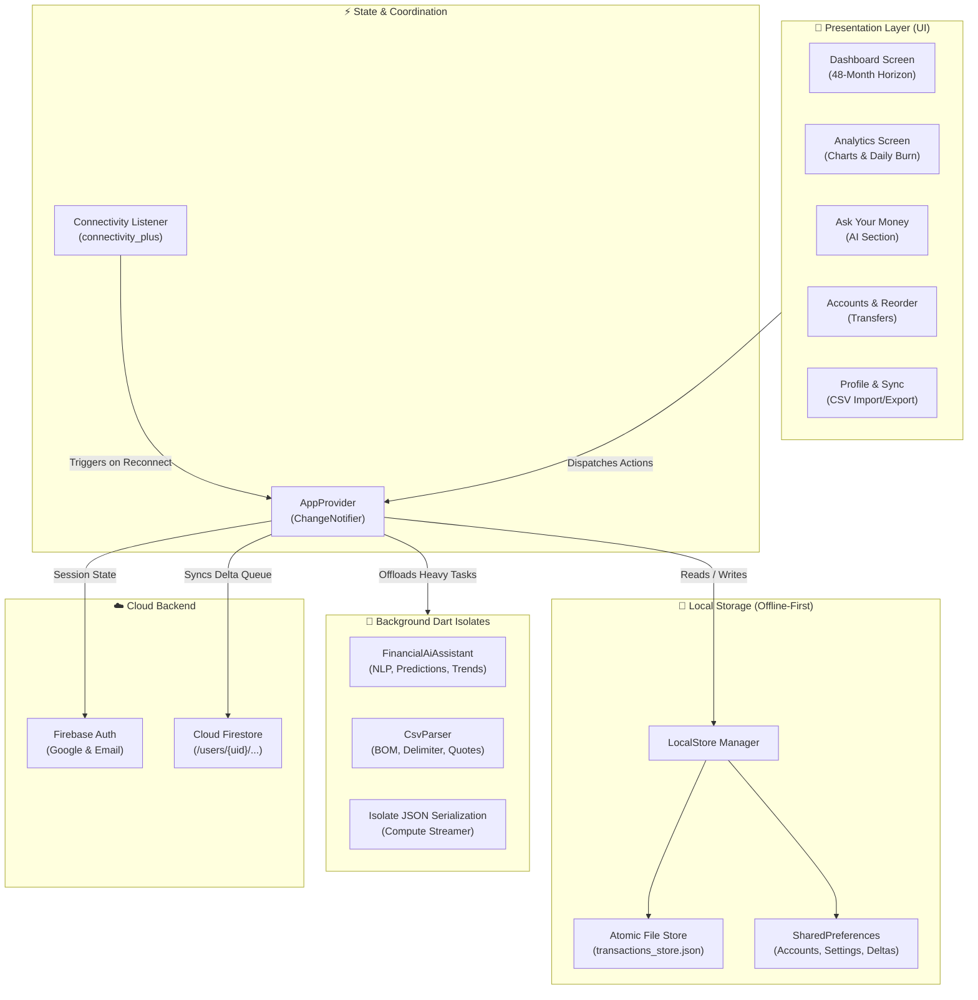

# 💰 Ducat — Personal Wealth & Finance Tracker

[](https://flutter.dev)
[](https://dart.dev)
[](https://firebase.google.com)
[](https://flutter.dev)
[](file:///test/)
[](LICENSE)

**Ducat** (My Money) is a state-of-the-art, offline-first personal wealth tracker built with **Flutter** and **Cloud Firestore**. Designed for absolute speed, privacy, and visual elegance, Ducat pairs a dark glassmorphic interface with an **on-device Natural Language Financial AI Assistant**, hardware-accelerated custom Canvas visualizations, dual-tier atomic storage, two-way CSV portability, and multi-currency support.

---

## 📑 Table of Contents

- [Key Highlights](#-key-highlights)
- [Feature Walkthrough](#-feature-walkthrough)
  - [🤖 On-Device Financial AI Assistant ("Ask Your Money")](#-on-device-financial-ai-assistant-ask-your-money)
  - [⚡ Offline-First Architecture & Delta Sync](#-offline-first-architecture--delta-sync)
  - [📊 Custom Canvas Analytics & Charts](#-custom-canvas-analytics--charts)
  - [🏦 Multi-Account Ledger & Inter-Account Transfers](#-multi-account-ledger--inter-account-transfers)
  - [🗂️ Dynamic Emoji-Validated Categories](#️-dynamic-emoji-validated-categories)
  - [📥 Two-Way CSV Portability (Import & Export)](#-two-way-csv-portability-import--export)
  - [🌍 Multi-Currency & Locale-Aware Formatting](#-multi-currency--locale-aware-formatting)
  - [🎨 Glassmorphism Design System](#-glassmorphism-design-system)
  - [🔐 Authentication & Cloud Isolation](#-authentication--cloud-isolation)
- [Architecture & Data Flow](#-architecture--data-flow)
- [Tech Stack](#️-tech-stack)
- [Project Structure](#-project-structure)
- [Data Models & Schema](#-data-models--schema)
- [Getting Started](#-getting-started)
  - [Prerequisites](#prerequisites)
  - [Installation & Firebase Setup](#installation--firebase-setup)
- [Firestore Security Rules](#-firestore-security-rules)
- [Testing & Quality Assurance](#-testing--quality-assurance)
- [License](#-license)

---

## 🌟 Key Highlights

- **100% Private On-Device AI**: Zero financial queries or transaction logs leave your device for AI processing. The natural language assistant runs in isolated Dart threads (`compute`) directly against your local ledger.
- **Atomic File Persistence**: Transaction histories are written atomically via temporary staging files and isolated serialization, eliminating the Android 1MB `TransactionTooLargeException` Binder crash limit.
- **Zero-Dependency Visualizations**: Concentric ring charts, touch-interactive trend graphs, and grouped bar charts are rendered with pure Flutter `CustomPainter` and Canvas APIs for 60/120 FPS buttery smoothness.
- **Two-Way CSV Synchronization**: Full data ownership with delimiter auto-detection (`,`, `;`, `\t`, `|`), BOM stripping, and append/overwrite conflict handling.
- **Real-Time Connectivity Lifecycle**: Auto-detects network restoration to flush queued offline deltas to Firestore with clear UI sync status badges.

---

## ✨ Feature Walkthrough

### 🤖 On-Device Financial AI Assistant ("Ask Your Money")

Embedded directly in the Analytics screen, the **Financial AI Assistant** provides instantaneous, privacy-preserving financial intelligence without calling third-party cloud LLMs.

- **Natural Language Understanding**: Ask conversational questions or tap suggested quick-prompt pills:
  - *"Monthly expenses"*
  - *"Which category spending has been increased or decreased from last month?"*
  - *"How much did I spend on food every month?"*
  - *"Predict expenses category-wise next month"*
  - *"Monthly savings"*
  - *"Show transactions above ₹1,000 this month"*
- **Predictive Forecasting**: Leverages historical spending velocities and weighted regressions to forecast month-end total outlay and next-month category-specific expenditures.
- **Deep Financial Insights**: Automatically calculates percentage deltas, generates contextual advice bullets (e.g., spending spikes, savings ratios), and provides direct drill-down access to matching transactions with tap-to-inspect modals.
- **Background Isolate Processing**: Heavy analytical computations execute in a dedicated Dart isolate via `compute()`, ensuring the UI never drops a single frame.

### ⚡ Offline-First Architecture & Delta Sync

Ducat is engineered to function flawlessly in planes, subways, or areas with zero connectivity.

- **Dual-Tier Storage Strategy**:
  - `SharedPreferences`: Stores lightweight configurations (user session, active currency, account order, sync timestamps).
  - `File Store` (`transactions_store.json` via `path_provider`): Persists full transaction records using atomic write-to-temp-and-rename semantics (`.tmp` -> `.json`), completely immune to process interruption or power loss.
- **Offline Delta Queue**: Mutations made while offline are staged in `ls_pending_deltas` and reconciled automatically when connectivity is restored via `connectivity_plus`.
- **Sync Status Indicator**: Real-time visual badge in the Profile header:
  - 🟢 **Cloud Synced**: All local changes match remote Firestore records.
  - 🟠 **Syncing...**: Active synchronization in progress with rotating spinner.
  - 🔴 **Sync Pending**: Local changes staged awaiting connectivity.
- **Manual Sync**: One-tap refresh button allows users to force cloud reconciliation on demand.

### 📊 Custom Canvas Analytics & Charts

Built without bulky third-party charting libraries for minimal bundle footprint and maximum control:

- **Animated Concentric Rings Chart**: Multi-ring donut chart visualizing category expense distribution with sweep entrance animations, percentage badges, and reactive ring selection.
- **Interactive Trend Line Graph**: Displays historical expense and income trajectories across selectable windows (**1M**, **3M**, **6M**, **1Y**, **ALL**). Includes a touch scrubber (`_activeTrendNotifier`) for point-by-point inspection.
- **Grouped Bar Charts**: Monthly comparison bars visualizing side-by-side cash inflow vs. cash outflow.
- **Active Daily Averages**: Calculates real daily burn rate based exclusively on active spending days.
- **Category Drill-Down Modals**: Tapping any category ring opens a frosted glass modal listing all relevant transactions, grouped by day with reverse/chronological sorting.

### 🏦 Multi-Account Ledger & Inter-Account Transfers

- **Flexible Account Types**: Manage Cash, Checking, Savings, Credit Cards, or Investment ledgers.
- **Inter-Account Transfers**: Move funds between accounts (Source $\to$ Destination) with atomic double-entry bookkeeping.
- **Tactile Drag-and-Drop Reordering**: Built with `ReorderableListView.builder`, animated proxy scaling, haptic feedback, and dynamic elevation shadows.
- **Live Balance Tracking**: Balances dynamically update with positive/negative color-coded styling.

### 🗂️ Dynamic Emoji-Validated Categories

- **Custom Categories**: Create tailored income and expense categories.
- **Unicode Emoji Validation**: Enforces single-emoji icons using strict Unicode regex matching (`^[^\x00-\x7F\p{L}\p{N}\p{P}\p{Z}]+$`).
- **Integrity Guard**: Checks category transaction counts before deletion to prevent orphaned transaction records.

### 📥 Two-Way CSV Portability (Import & Export)

- **Smart Delimiter Detection**: Analyzes the first 10 rows to detect `,`, `;`, `\t`, or `|` delimiters.
- **Sanitization Pipeline**: Automatically strips UTF-8 Byte Order Marks (`\ufeff`) and Excel separator metadata headers (`sep=;`).
- **Conflict Resolution Dialog**: Prompts whether to **Append** imported records or **Overwrite** the existing database.
- **Native Share Sheet**: Exports clean CSV spreadsheets compatible with Excel, Google Sheets, and Apple Numbers via `share_plus`.

### 🌍 Multi-Currency & Locale-Aware Formatting

- **9 Global Currencies**: USD (`$`), INR (`₹`), GBP (`£`), EUR (`€`), JPY (`¥`), CAD (`CA$`), AUD (`A$`), AED (`د.إ`), and SGD (`S$`).
- **Locale-Aware Number Formatting**: Built-in support for Indian numbering formatting (`1,00,000.00` via `en_IN`) and standard international formats.
- **Corrupted Symbol Self-Healing**: Includes an automatic migration script that repairs legacy encoding artifacts from earlier configurations.

### 🎨 Glassmorphism Design System

- **Visual Theme**: Deep dark teal backdrop (`assets/dark_teal_bg.jpg`) layered with translucent cards.
- **Real-Time Blur**: Custom `GlassCardWidget` and `GlassModalDialog` utilize `ui.ImageFilter.blur(sigmaX: 15, sigmaY: 15)` for authentic glassmorphism.
- **Typography FOIT Prevention**: Pre-warms Google Fonts (`Fraunces`, `Castoro`, `Inter`) during app boot to prevent Flash of Unstyled/Invisible Text.

### 🔐 Authentication & Cloud Isolation

- **Firebase Auth**: Supports both Google One-Tap Sign-In and Email/Password authentication.
- **Strict User Isolation**: All Firestore paths are strictly scoped under `users/{uid}`, guaranteeing absolute multi-tenant data separation.
- **Guest / Offline Mode**: Users can operate completely offline without active internet connectivity.

---

## 🏗️ Architecture & Data Flow



---

## 🛠️ Tech Stack

| Domain | Technology / Package | Purpose |
|---|---|---|
| **Framework** | [Flutter](https://flutter.dev) (Dart SDK `^3.12.2`) | Cross-platform native compilation |
| **State Management** | [`provider ^6.1.5`](https://pub.dev/packages/provider) | Reactive dependency injection & state propagation |
| **Cloud Database** | [`cloud_firestore ^6.6.0`](https://pub.dev/packages/cloud_firestore) | Remote multi-device document database |
| **Authentication** | [`firebase_auth ^6.5.4`](https://pub.dev/packages/firebase_auth), [`google_sign_in ^6.2.1`](https://pub.dev/packages/google_sign_in) | Secure federated and credential-based login |
| **Local Persistence** | [`path_provider ^2.1.6`](https://pub.dev/packages/path_provider), [`shared_preferences ^2.5.5`](https://pub.dev/packages/shared_preferences) | Dual-tier atomic file storage & settings cache |
| **Data Visualizations** | Custom Canvas / `CustomPainter` | Hardware-accelerated concentric rings, lines, and bar charts |
| **AI Intelligence** | Custom On-Device Isolate Engine | Private Natural Language Understanding & predictive regression |
| **Network Lifecycle** | [`connectivity_plus ^6.1.4`](https://pub.dev/packages/connectivity_plus) | Real-time offline-to-online transition triggers |
| **Data Portability** | [`csv ^8.0.0`](https://pub.dev/packages/csv), [`file_picker ^10.3.10`](https://pub.dev/packages/file_picker), [`share_plus ^12.0.2`](https://pub.dev/packages/share_plus) | Delimiter auto-detection CSV import & export |
| **Media Handling** | [`image_picker ^1.2.3`](https://pub.dev/packages/image_picker) | User profile avatar selection |
| **Typography & Formats**| [`google_fonts ^8.1.0`](https://pub.dev/packages/google_fonts), [`intl ^0.20.3`](https://pub.dev/packages/intl) | Font preheating & multi-locale currency formatting |

---

## 📁 Project Structure

```text
my_money_flutter/
├── assets/                          # Static image & icon assets
│   ├── dark_teal_bg.jpg             # Primary glassmorphism backdrop
│   ├── google.png                   # Google OAuth button asset
│   └── icon.png                     # App launcher icon
├── lib/
│   ├── main.dart                    # App bootstrap, font preloading, Firebase init
│   ├── core/                        # Global foundational utilities
│   │   ├── csv_parser.dart          # Delimiter auto-detection & line parser
│   │   ├── currency_format.dart     # International & Indian numbering formatters
│   │   └── theme.dart               # Dark glassmorphic ThemeData & AppColors
│   ├── models/
│   │   └── models.dart              # AppUser, Account, TransactionModel, CategoryModel, CurrencyModel
│   ├── providers/
│   │   └── app_provider.dart        # Central ChangeNotifier, Firestore delta sync, account transfers
│   ├── services/
│   │   ├── financial_ai_assistant.dart # On-device NLP engine, predictions, trend calculations
│   │   └── local_store.dart         # Atomic file store, isolate JSON parser, delta queues
│   └── ui/
│       ├── base/                    # Reusable base architectural widgets
│       │   ├── base_card.dart       # GlassCardWidget & SolidCardWidget
│       │   ├── base_dialog.dart     # Frosted glass popups & modal sheets
│       │   ├── base_screen.dart     # Scaffold wrapper with safe area & background handling
│       │   └── ui_factory.dart      # Standardized headers & empty-state placeholders
│       ├── components/              # Feature-specific interactive components
│       │   ├── add_transaction_form.dart # Modal sheet for Expense/Income/Transfer
│       │   ├── ask_your_money_section.dart # AI query bar, suggestion chips, insight cards
│       │   ├── charts.dart          # CustomPainter Concentric Rings, Trend Graph, Bar Chart
│       │   ├── dropdown_selector.dart # Frosted dropdown modal picker
│       │   ├── floating_action_button.dart # Morphing quick-add FloatingActionButton
│       │   ├── transaction_item.dart # Swipable/tapable transaction card
│       │   └── validation_dialog.dart # Alert and confirmation dialogs
│       └── screens/                 # Top-level screen views
│           ├── app_navigator.dart   # Bottom navigation shell with tab state preservation
│           ├── dashboard_screen.dart # 48-month horizon picker, balance cards, daily transactions
│           ├── analytics_screen.dart # Category breakdown, burn rates, AI integration
│           ├── accounts_screen.dart # Reorderable account cards, inter-account transfers
│           ├── categories_screen.dart # Category CRUD with emoji validation
│           ├── profile_screen.dart  # Sync status, currency selection, CSV import/export
│           ├── login_screen.dart    # Firebase authentication screen
│           └── onboarding_screen.dart # Welcome & introduction walkthrough
└── test/                            # Unit & widget test suites (62 tests)
    ├── csv_parser_test.dart         # Tests for delimiters, BOM removal, quote handling
    ├── currency_format_test.dart    # Number formatting & symbol preservation tests
    ├── financial_ai_assistant_test.dart # 33 NLP, prediction, and edge-case engine tests
    ├── models_test.dart             # Model serialization & fallback parsing tests
    └── widget_test.dart             # Component layout & render tree tests
```

---

## 🗃️ Data Models & Schema

### Data Models

| Model | Key Fields | Descriptions |
|---|---|---|
| `AppUser` | `uid`, `email`, `name`, `photoPath` | Represents authenticated user identity and profile avatar. |
| `Account` | `id`, `name`, `balance`, `createdAt`, `position` | Individual account ledger with draggable order index. |
| `TransactionModel` | `id`, `amount`, `type`, `categoryId`, `accountId`, `toAccountId`, `note`, `date` | Core financial record. `type` can be `expense`, `income`, or `transfer`. |
| `CategoryModel` | `id`, `name`, `icon`, `type` | Classification item. `icon` is a single Unicode emoji; `type` is `expense` or `income`. |
| `CurrencyModel` | `code`, `symbol`, `name` | Active currency settings (e.g., `USD`, `$`, `United States Dollar`). |

### Firestore Schema Layout

```text
users/
└── {uid}/
    ├── profile/
    │   └── data: { name, email, currency }
    ├── accounts/
    │   └── {accountId}: { name, balance, position, createdAt }
    ├── categories/
    │   └── {categoryId}: { name, icon, type }
    └── transactions/
        └── {transactionId}: { amount, type, categoryId, accountId, toAccountId, note, date }
```

---

## 🚀 Getting Started

### Prerequisites

- [Flutter SDK](https://docs.flutter.dev/get-started/install) `>=3.12.2`
- [Dart SDK](https://dart.dev/get-dart) `^3.12.2`
- Android Studio / VS Code with Flutter and Dart extensions
- A Google Firebase account with Authentication and Cloud Firestore enabled

### Installation & Firebase Setup

#### 1. Clone the repository
```bash
git clone https://github.com/your-username/my_money_flutter.git
cd my_money_flutter
```

#### 2. Install dependencies
```bash
flutter pub get
```

#### 3. Configure Firebase

1. Navigate to the [Firebase Console](https://console.firebase.google.com/) and create a new project.
2. Enable **Authentication** with the following sign-in providers:
   - **Email/Password**
   - **Google Sign-In**
3. Create a **Cloud Firestore** database.
4. **Android Setup**:
   - Register your Android app package name (found in `android/app/build.gradle`).
   - Download `google-services.json` and place it in `android/app/`.
   - Add your SHA-1 fingerprint in the Firebase Console (required for Google Sign-In):
     ```bash
     cd android && ./gradlew signingReport
     ```
5. **iOS Setup**:
   - Register your iOS bundle identifier.
   - Download `GoogleService-Info.plist` and place it in `ios/Runner/` via Xcode.
   - Configure the reversed client ID URL scheme in Xcode under `Info -> URL Types`.

#### 4. Run the Application
```bash
# Run on connected device or emulator
flutter run

# Run on a specific device
flutter run -d chrome
flutter run -d android
flutter run -d ios
```

---

## 🔒 Firestore Security Rules

Ensure multi-tenant isolation by deploying the following security rules in your Firebase Console:

```javascript
rules_version = '2';
service cloud.firestore {
  match /databases/{database}/documents {
    match /users/{userId}/{document=**} {
      allow read, write: if request.auth != null && request.auth.uid == userId;
    }
  }
}
```

---

## 🧪 Testing & Quality Assurance

Ducat includes a comprehensive unit and widget test suite covering models, data parsing, isolate computations, and the on-device AI assistant engine:

```bash
# Run all test suites
flutter test

# Run the Financial AI Assistant engine tests
flutter test test/financial_ai_assistant_test.dart

# Run CSV parser and edge-case tests
flutter test test/csv_parser_test.dart

# Run models and serialization tests
flutter test test/models_test.dart
```

### Test Suite Breakdown

- **`financial_ai_assistant_test.dart` (33 tests)**:
  - Total spending and transaction counts
  - Category spending queries with month-over-month deltas
  - Threshold filtering (e.g. *transactions above ₹1,000*)
  - Category-wise expense and income predictive forecasting
  - Month-end projected expenditure
  - Historical monthly series and savings calculations
  - Intent conflict guards (*"Food every month"* [Historical] vs *"Food next month"* [Prediction])
  - Graceful edge-case handling on blank or malformed inputs
- **`csv_parser_test.dart`**: Delimiter detection (`,`, `;`, `\t`, `|`), quote handling, and BOM stripping.
- **`currency_format_test.dart`**: Locale formatting and Indian numbering system verification.
- **`models_test.dart`**: Null safety, factory constructors, and JSON serialization.
- **`widget_test.dart`**: Render tree integrity and navigation validation.

---

## 📱 Platform Support

| Platform | Status | Notes |
|---|---|---|
| **Android** | ✅ Supported | Native ARM/x86_64, Material 3, Haptics |
| **iOS** | ✅ Supported | Full Cupertino support, Haptics, ShareSheet |
| **Web** | 🔧 Partial | Responsive layout, local file exports |
| **Windows / macOS / Linux** | 🔧 Partial | Desktop window frame compatible |

---

## 🤝 Contributing

Contributions are welcome! Please follow these steps:

1. Fork the Project
2. Create your Feature Branch (`git checkout -b feature/AmazingFeature`)
3. Commit your Changes (`git commit -m 'Add some AmazingFeature'`)
4. Ensure all tests pass (`flutter test`)
5. Push to the Branch (`git push origin feature/AmazingFeature`)
6. Open a Pull Request

---

## 📄 License

This project is licensed under the MIT License — see the [LICENSE](LICENSE) file for details.
